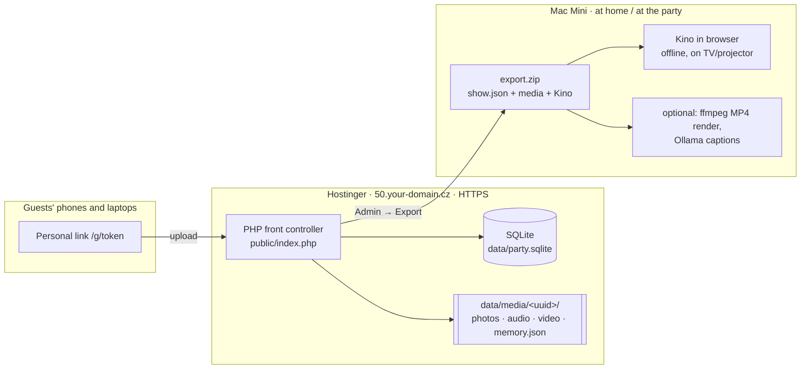

# Adamových 50 – solution architecture

A private Czech-language microsite. Guests open a personal link, add memories (text, photos, short videos, voice messages). On the day of the party, everything turns into a self-running, interactive "Kino" film that plays in the browser, and it works offline too.

## 1. Goals and constraints

| Goal | How the design handles it |
|---|---|
| 25–30 guests, some couples | One **household** = one personal link. A couple shares a link, and each memory records *which* of them wrote it (`authors`). |
| Every submission attributed | Identity comes from the link token, not typed names, so attribution is never wrong or misspelled. |
| Low friction on phones | No accounts or passwords. Mobile-first form. Photos are shrunk in the browser before upload. Voice is recorded in the browser. |
| Storage that is easy to consolidate later | SQLite index **plus** a self-describing folder per memory (`memory.json` + media), exported as one ZIP with `show.json`. |
| Final "movie" | Kino player builds the storyline automatically (decades, then undated memories, then wishes, then finale) from `show.json`. |
| Host on Hostinger or Mac Mini | Plain PHP 8 + SQLite with no build step: runs on Hostinger shared/cloud hosting, in Docker on the Mac, or with `php -S`. |
| Party venue may have bad Wi-Fi | Export = static offline package; the Mac plays it locally. |

## 2. Recommended topology (hybrid)



**Why Hostinger for collecting:** guests need a public HTTPS URL that is reliably up for weeks. Your Hostinger Cloud plan already has PHP 8, SQLite, SSL, backups and Git deploy, with nothing to keep running at home.
**Why the Mac Mini for the party:** big files play smoothly from local disk, there's no dependence on venue internet, and it's the place for heavier optional steps (an MP4 render, local-LLM helpers).

Alternative: run everything on the Mac Mini (`docker compose up -d` + a Cloudflare Tunnel to your domain). It works, but the Mac then has to stay online, awake and patched for the whole collection window.

## 3. Components

```
public/                 web root (only this is exposed)
  index.php             router: pages, JSON API, auth-checked media serving (HTTP Range for Safari)
  assets/css/app.css    one design system for guest page, admin and Kino
  assets/js/app.js      guest page: composer, client-side resize, voice recorder, edit/delete
  assets/js/kino.js     the player: storyline builder, Ken Burns, word-reveal, audio ducking, guess game
  assets/js/admin.js    "director's booth": guests, QR codes, invite text, moderation, export
  assets/fonts/         self-hosted Fraunces + Inter (no Google Fonts → no GDPR issue)
app/
  bootstrap.php         config, SQLite + migrations, sessions, helpers
  media.php             upload processing (GD re-encode), sidecars, show payload, export ZIP
  views/*.php           landing, guest, admin, kino
  config.php            your settings (git-ignored) ← copy from config.example.php
data/                   (git-ignored) party.sqlite, media/, sessions/
tools/                  seed-demo.php, build-demo.php, export.php
```

### Routes

| Route | Who | Purpose |
|---|---|---|
| `GET /g/{token}` | guest | sets a 120-day session cookie, redirects to `/` |
| `GET /` | guest | landing (code entry) or the guest app |
| `GET /api/me` | guest | household, config, own memories, stats, wall (if open) |
| `POST /api/memories[/{id}]` | guest | create / edit (multipart; photos, video, `audio`, `remove_media[]`) |
| `DELETE /api/memories/{id}` | guest | delete own memory + files |
| `GET /m/{uuid}/{file}` | guest/admin | media with permission check + Range support |
| `GET /admin?k=…` | you | admin (the key is moved into the session and stripped from the URL) |
| `GET /admin/export.zip` | you | offline party package |
| `GET /kino` | admin; guests after `kino_public_from` | the film |
| `GET /api/show` | same as Kino | `show.json` dataset |

## 4. Data model and the consolidation contract

```
households(id, token UNIQUE, label "Petra a Honza", names_json ["Petra","Honza"], relation, created_at, last_seen)
memories(id UUID, household_id, authors_json, title, body, year?, tags_json, is_wish, status visible|hidden, created_at, updated_at)
media(id, memory_id, kind photo|audio|video, file, thumb, mime, width, height, bytes, sort, created_at)
```

On disk every memory is self-contained, so it can be rebuilt even without the DB:

```
data/media/6d69…-7b2c/
  00-a1b2c3.jpg          ≤2560 px, EXIF/GPS stripped
  00-a1b2c3.thumb.jpg    640 px
  01-d4e5f6.webm         voice message (as recorded)
  memory.json            full record incl. authors, household label, year, tags
```

The **export ZIP** (`Admin → Export pro oslavu`, or `php tools/export.php`) contains:

- `show.json`: schema `p50.show/1`. It holds celebrant, birth year and the list of memories, each with its media list. **This is the file to hand back to Claude** for consolidation, edits, captions or a scripted MP4.
- `guests.json`: households, names, relation, last visit (to see who hasn't contributed yet).
- `media/<uuid>/…`: all files plus `memory.json`.
- `index.html` + `assets/`: Kino, ready to run offline.

## 5. Key flows

**Invite:** in Admin you paste households one per line (`Jana a Pavel; sousedé`). Each one gets a token, a link, a QR code and a pre-written Czech WhatsApp/e-mail invite you can copy.

**Submit:** the guest picks who's writing, the year (slider showing "Adamovi 19 · studia"), writes a story (with a "Došla slova?" prompt generator), adds photos/videos, optionally records a voice note, adds tags or marks it as a wish. The phone shrinks photos to 2560 px JPEG, uploads with a progress bar, then shows confetti. The server checks the MIME type, re-encodes images (which also neutralises fake images and strips GPS), stores audio/video as-is, and writes `memory.json`.

**Surprise mode:** by default guests see only their own memories plus a sealed-envelope teaser and a live counter. The wall opens at party start (`wall_visible_before_party`).

**Kino:** the storyline is built automatically: title (counter 1976 → 2026), then chapters by decade ("Osmdesátá léta · Adamovi 4–13"), memories sorted by year, then undated ones, then wishes, then a finale photo mosaic with confetti.
- Photo slides use a Ken Burns effect with blurred fill for portrait shots. Long stories switch to a split layout.
- Text-only memories reveal word by word.
- Voice notes play with a live visualiser while the music ducks automatically. Videos play inline.
- Keys: Space, ←/→, F, G (overview grid), R (random), M (music), Enter. The progress bar has chapter marks and is clickable.
- **"Hádej, kdo to napsal" game:** author names stay blurred until you press Enter.

## 6. Security and privacy

- Tokens are 10 characters from a 31-symbol alphabet (~49 bits), with no listing endpoint. `noindex` is set everywhere.
- The session cookie is `HttpOnly`, `SameSite=Lax` and `Secure` on HTTPS. State-changing API calls require the custom `X-P50` header, which blocks CSRF from other sites.
- Uploads: `finfo` MIME whitelist. Images are re-encoded by GD. Media live outside the web root and are served through PHP with `nosniff` and a permission check.
- The admin key is compared with `hash_equals`, then kept in the session only.
- GDPR (light touch, private event): explain the purpose in the footer, strip GPS, let guests edit or delete their own entries, delete the data some weeks after the party, and keep fonts self-hosted.

## 7. Deployment

**Hostinger (recommended):**
1. In hPanel create a subdomain, e.g. `50.akpro.cz`, and enable SSL.
2. Either use hPanel → Git → deploy this repo into the subdomain folder (the root `.htaccess` exposes only `public/` and blocks `app/`, `data/`, `tools/`), or rsync over SSH (`rsync -az --exclude data -e "ssh -p 65002" ./ u123@host:domains/…/public_html/`).
3. Create `app/config.php` on the server (`admin_key`, `base_url`, dates). Optionally set `data_dir` outside `public_html`.
4. In hPanel → PHP Configuration, check: PHP ≥ 8.1, extensions `gd`, `pdo_sqlite`, `zip`, `exif`, `fileinfo`; `upload_max_filesize` ≥ 256M (`.user.ini` is included).
5. Open `/admin?k=…`, add guests, send the links.

**Mac Mini:** `docker compose up -d`, then go public with `cloudflared tunnel`. For local development: `php -S localhost:8050 -t public public/index.php`.

**Party day:** export the ZIP the evening before (and again right before the party), unzip it on the Mac, run `python3 -m http.server 8050`, open Chrome in full screen, press F, and connect HDMI/AirPlay to the TV or projector.

## 8. Roadmap / optional extensions

- **MP4 render** (souvenir after the party): headless Chrome screen-recording of Kino, or an ffmpeg script generated from `show.json`.
- **Local AI on the Mac Mini (Ollama):** auto-titles for untitled memories, merging duplicate photos, one-line chapter intros, a printed "book of memories" PDF.
- Video transcoding (ffmpeg → H.264 MP4) for clips recorded as HEVC/WebM, so every browser plays them.
- E-mail reminders to households that haven't contributed (`guests.json` shows who).
